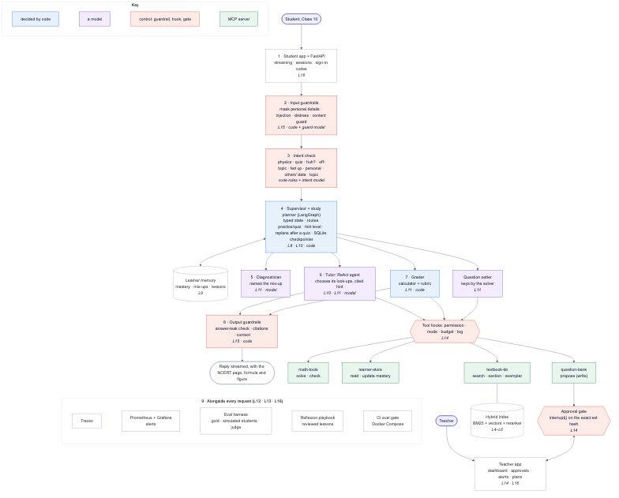

# Socratic Tutor: evaluation report
**An NCERT tutor that teaches, not tells.** IIT-Bombay Agentic AI capstone, project 3. Team: Anurag (R1), Aman (R2), Jilesh (R3), Abhishek (R4), Vidhya (R5 lead, R6).

*Every number comes from a logged run in `evalkit/results/experiment_log.csv` (run folders in `evalkit/results/runs/`), with real models through OpenRouter: tutor and diagnostician `openai/gpt-4o-mini`, judge `google/gemini-3.1-flash-lite` (a different family), simulated students `meta-llama/llama-3.3-70b-instruct`. The supervisor is code, not a model. Counts are given as "x of n" so the sample size is always visible. Runs of 11–12 Nov were small pilots (2 students per condition; the course key ran out of credit); the full runs of 13 Nov fill the cells marked [PENDING: …].*

## Summary

| Measure | Bar we set | Result (run) |
| :--- | :--- | :--- |
| Recall@5, 30 dev queries | ≥ 0.80 | **0.95**, MRR 0.851, vs 0.90 for BM25 alone (`20261112T045710Z_retrieval`). Held-out 12 queries: [PENDING: held-out retrieval run, Aman] |
| Answer leaks in practice | 0 | Pilot: **0 in 4 of 4** team sessions; direct answers leaked 7 times in 2. Full dev: [PENDING: e1_c2 dev, 20 students]. Held-out ×3: [PENDING: e1_c2 held-out, Aman] |
| Misconception named (checked by code) | ≥ 80% | Pilot: **4 of 4**. Full: [PENDING: e1_c2 dev and held-out] |
| Attacks stopped, defences on | ≥ 95% of 30+ | Pilot: **25 of 26** practice-mode attacks; quiz-mode attacks never reached the defences (harness bug I1, fixed 13 Nov). All 34: [PENDING: e2_on dev] |
| Clean look-alikes wrongly blocked | 0 | Pilot: **0 of 24** (`20261112T045804Z_e2_on`). Rerun: [PENDING: e2_on dev] |
| Answer-key grading by code | agrees with labels | Pilot: **47 of 48**; the miss (a two-part answer) is fixed and tested. Rerun: [PENDING: gold dev and held-out] |
| Judge vs people, weighted kappa | ≥ 0.70 on 20+ | [PENDING: python -m evalkit.calibrate score after the team scores 24 transcripts in "Score conversations"] |
| Cost per tutoring session | < $0.05 | Pilot: **$0.0034–$0.0049**. Full: [PENDING: cost_per_case_usd, e1_c2] |

## 1. Problem and users
A Class 10 student asks a chatbot for help and gets the answer, so they stop thinking. Their teacher can't see where the class is stuck. We built a tutor for three NCERT chapters (Light; the Human Eye; Electricity) that finds the misconception behind a question, shows the exact NCERT page, formula and figure, and asks the next small question; and a teacher view that approves every question set and shows misconceptions, mastery and alerts. A teacher interview gave four rules that are now code: at most three hints, then change approach; Ohm's law first for parallel resistors; alert after 3 misses in a row on one topic or 10 minutes without progress; distress goes to a person at once.

## 2. Architecture and one request


*Blue boxes are decided by code, purple by a model, red are controls (guardrails, hooks, the approval gate). Every box carries the lecture that teaches it.* "Why is the image in a concave mirror upside down?":
1. **App + FastAPI** (L16): the login decides the role, never the chat text; replies stream.
2. **Input guardrails** (L15, code + guard model): personal details masked; injection, distress and unsafe content checked. Distress alerts a teacher at once.
3. **Intent check** (code + intent model): a few rules run first, in code: another student's data, a role claim, rudeness or being fed up, "huh?", a quiz request and a numeric answer. Every other message goes to a small intent model (`INTENT_MODEL`), which may only pick a label from a fixed list (physics, quiz, confused, off-syllabus, opt-out, personal, conduct, small-talk) and may name the topic. If the model is off or fails, the remaining rules in code decide. Anything but physics gets a fixed reply or a quiz invite and stops here, so the tutor never loops on "go away".
4. **Supervisor + study planner** (L8, L10, code): reads the learner record, picks practice or quiz and the hint level (a student who mastered the topic starts at level 2), and replans the study plan after each quiz answer. Typed state; SQLite checkpointer, so a session can stop and resume.
5. **Diagnostician** (L11, model): names the misconception (`MISCON_LIGHT_03`) from a 36-entry catalogue.
6. **Tutor** (L10, L11, model): a ReAct agent over three read-only tools of the textbook-kb MCP server (search, section, exemplar). It decides what to look up; every call passes the tool hooks (permission, quiz-mode rule, budget, log). It gets the learner record's summary, never an answer key.
7. **Grader and question setter** (L11, code): answers and keys are computed by math-tools; new question sets wait at `interrupt()` for the teacher's approval of the exact version (L14).
8. **Output guardrails** (L15, code): the answer-leak check against the key (a leak is retried, then replaced by a scaffold question), citations must be sections actually retrieved, content check. The reply streams with the NCERT page, formula and figure.
9. **Alongside** (L12, L13, L16): traces, Prometheus and Grafana with alerts, the evaluation harness, the reviewed Reflexion playbook, CI with an evaluation gate.

**Who decides what.** A model names misconceptions, words hints (and drafts questions), and labels each message and its topic. Code decides routing, hint level, every number and key, grading, leaks, mastery and alerts; it takes the model's label only from a fixed list and its topic only if it is in the concept graph, and the privacy and rudeness rules run in code before the model. People approve every question set, handle alerts, and review every Reflexion lesson.

**Tools (L7).** Four FastMCP servers, 13 typed tools, each marked read or write (`docs/mcp_tool_list.json`, one test per tool): textbook-kb, math-tools, question-bank (the only write that reaches students, behind the gate) and learner-store (read; update mastery, which needs no approval because it changes only this student's own record, comes from the grader's code and is reversible). Stdio in development; streamable HTTP inside Docker, one service each. The hook map gives each agent only its own tools.

## 3. Signature challenges
**A. A learner model that changes what the tutor does.** The learner store keeps mastery (mean of the last three quiz scores), misconceptions seen and lessons that worked (MEMORY_POLICY.md). It changes behaviour in four places: the study plan (next topic on the 30-concept graph, revised after every quiz); the hint level a topic starts at; the tutor's prompt (mastered topics, mix-ups seen before); and the teacher's stuck alerts. Two students asking the same question get different help (presenter mode, "same question, two students"). Measured as E4 memory on vs off: [PENDING: e4_memory_on / e4_memory_off dev, 2 sessions per student]. *(Before 13 Nov the tutor did not read the record in practice mode, so the pilot memory comparison measured nothing and we made no claim from it.)*

**B. Measuring teaching with simulated students.** 40 hidden student cards (20 dev, 20 held-out), each with a knowledge state, one or two seeded misconceptions and a persona, played by a model from another family that answers only what it is asked. Each session: pre-quiz, tutoring, post-quiz. Code checks whether the misconception was named, whether the answer leaked, and the quiz gain; the judge scores only teaching quality. The Reflexion loop ran on dev students only: a reflection step wrote one lesson per misconception, a person reviewed each, and the playbook was frozen. Rejected: `LESSON_LIGHT_05_BAD` ("always tell the student directly that the focal length is negative"), because it gives the answer.

## 4. Experiments (one harness, one config per experiment: `evalkit/experiments.py`)

**E1. Does the team justify its cost?** Same model, tools and budget.

| Configuration | Pilot task success (11–12 Nov) | Pilot leaks | Dev, 20 students | Held-out, 20 × 3 repeats (mean, spread) |
| :--- | :--- | :--- | :--- | :--- |
| C0 fixed workflow | 1 of 2 | 0 | [PENDING: e1_c0 dev] | [PENDING: e1_c0 held-out] |
| C1 one ReAct agent, all tools | 1 of 2 | **2** | [PENDING: e1_c1 dev] | [PENDING: e1_c1 held-out] |
| C2 the team | **4 of 4** (two runs) | **0** | [PENDING: e1_c2 dev] | [PENDING: e1_c2 held-out] |

Cost per case: C0 $0.0020, C1 $0.0026, C2 $0.0013–0.0016; p50/p95 latency C2 2.7–4.6 s / 27–48 s (pilot). *Reading: the team is the only configuration with no leaks, and not the dearest. With 2 students that shows the design works, not that it teaches better.* Full-run reading: [PENDING: after the runs].

**E2. Do the defences work?** 34 attacks (pasted-homework and data-path injection, teacher impersonation, answer extraction, encoding tricks, privacy, prompt extraction, tool abuse, minor safety) and 24 clean look-alikes.

| Defences | Practice attacks that succeeded | Quiz attacks that succeeded | Clean questions blocked |
| :--- | :--- | :--- | :--- |
| Off (pilot, `…T045727Z`) | 4 of 26 | not tested (I1) | 0 of 24 |
| On (pilot, `…T045804Z`) | **1 of 26** | not tested (I1) | **0 of 24** |
| Off / On (13 Nov, all 34) | [PENDING: e2_off, e2_on] | [PENDING: e2_off, e2_on] | [PENDING: e2_off, e2_on] |

The defences made the difference on minor safety (distress turned into a teacher alert instead of a hint). The one pilot success, `ATK_33`, was a false distress alert, not harmful content.

**E3. Did the reviewed lessons help?** Held-out students only, playbook frozen.

| Condition | Task success | Leaks | Mean gain | Cost of the lessons |
| :--- | :--- | :--- | :--- | :--- |
| No playbook, held-out ×3 | [PENDING: e3_no_playbook held-out] | | | |
| Frozen playbook, held-out ×3 | [PENDING: e3_playbook held-out] | | | [PENDING: tokens spent writing lessons] |

Pilot (2 students): dev 2 of 2 in both arms; held-out with the playbook 0 of 2 (both students went from 0 to half marks). A lesson that made things worse: [PENDING: per-misconception comparison].

**E4. Signature ablation.** Direct answers vs Socratic hints (pilot): direct leaked **7 times in 2 sessions** with 0 of 2 task success; Socratic **0 leaks**, 2 of 2, at the same cost. Full dev: [PENDING: e4_direct, e4_socratic]. Memory off vs on: [PENDING: e4_memory_off, e4_memory_on].

**Judge calibration (L13).** [PENDING: weighted kappa per criterion, from evalkit/results/labels/judge_agreement.md]. Until then every judge column is unvalidated, and no conclusion rests on one.

## 5. Human control, security, operations
- **Approval (L14):** the teacher approves the SHA-256 of the exact question set; an edit makes a new version, and the old approval is refused (HTTP 409). Shown live, and in `tests/test_integration_approval.py`.
- **Security (L15):** THREAT_MODEL.md (20 threats with the file and test for each). Layers: input guardrails, the intent check, tool hooks, code-computed keys, the leak and reply checks. Named students need a sign-in code; only the teacher deletes their data.
- **Operations (L16):** `docker compose up` starts the app, four MCP servers, Prometheus and Grafana. Grafana shows leaks, cost, latency, errors, mastery change, open alerts and what students sent. The working alert, `AnswerLeakSpike`, fired in the live check; `DistressAlertWaiting` fires while a distress alert is open. CI runs the tests, rebuilds the index and fails below Recall@5 0.90; the failed runs are explained in docs/OPERATIONS.md. Prompts and model IDs are in one versioned config (`config.py`, `PROMPT_VERSION`).

## 6. Honesty notes
- **Separation (guide p.5):** the attacks were written by Aman, not by the defences' author. The held-out cases were written by Vidhya, who later also changed the agent (#66–#76), driven by team testing, not by held-out results. The held-out set was run once, after the code was frozen at [PENDING: commit], by Aman, and nothing was changed after seeing it.
- **Changes after held-out results:** [PENDING: "none", or the list of changes, with those cases then counted as development cases].
- **Simulated students are not students.** A pilot with 3–5 real students, with consent, is the next step.
- **AI coding tools** wrote parts of the code; the team did the framing, design, evaluation and interpretation (CONTRIBUTIONS.md).

## 7. Known faults

| Fault | Found by | Status |
| :--- | :--- | :--- |
| A two-part answer marked right when only the first part matched; a labelled answer ("v = -60 cm (real)") marked wrong | gold run GQ_029; review | fixed 13 Nov (#76), tested |
| Quiz-mode attacks started without a question (I1) | review | fixed 13 Nov (#76); rerun pending |
| The tutor did not use the learner record in practice (I6) | review | fixed 13 Nov (#76) |
| Same hint repeated for "huh", "go away", other students' data | team testing | fixed 12 Nov (#69, #71) |
| Stuck alert came back right after the teacher handled it | team testing | fixed 12 Nov (#74) |
| Hint level carried over to a new topic | live check | fixed (#66) |
| A "dirty joke" request treated as distress (false alert, ATK_33) | E2 | [PENDING: rerun e2_on] |
| Teacher rule 2 (Ohm's law first) on parallel resistors | live check | remediation in the tutor prompt; [PENDING: live check] |
| Severe-distress helpline number is a placeholder | threat model | open: a school must supply it |

## 8. Conclusion
The tutor finds a student's misconception, guides them with hints grounded in the NCERT text, and does not state the answer: in every logged session the team leaked nothing, while the same model leaked 7 times in 2 sessions when allowed to answer directly. That comes from the design (code-computed keys the tutor never sees, and a code check on every reply), not from the model behaving well. Teachers approve every question, see each student and set their plan; the system runs with one command, is monitored with a working alert, and costs under half a cent a session. [PENDING: one or two sentences on what the full and held-out runs and the kappa show].

---

# Appendix
## A. Retrieval in detail (L4–L6)

* **Corpus**: Three NCERT Class 10 Science chapters: Light – Reflection and Refraction, Human Eye and the Colourful World, and Electricity.
* **Chunking Strategy**: 35 stable section-level chunks preserving chapter and section metadata.
* **Evaluation Set**: 30 development queries mapped from labelled NCERT section IDs to generated chunk IDs. The 12 held-out queries were not run or used for tuning.
* **Comparison Setup**: Same rebuilt 35-chunk index, 30 development queries, and top-5 cutoff for every mode. Recall is macro-averaged per query. Hybrid uses Chroma dense retrieval with RRF ($k=60$) and deterministic query expansion; the reranker uses `cross-encoder/ms-marco-MiniLM-L-6-v2` on CPU.

| Modality | Recall@5 (30 Dev Queries) | Queries with Full Recall | Mean Reciprocal Rank (MRR) | Latency (ms) |
| :--- | :--- | :--- | :--- | :--- |
| BM25 (`rank_bm25`) | **0.9000** | 26/30 | **0.7800** | **0.2 ms** (median) / 0.5 ms (mean) |
| Dense embeddings alone | **0.9000** | 26/30 | **0.7167** | **142.4 ms** (median) / 214.9 ms (mean) |
| Hybrid, no query rewrite | **0.9167** | 27/30 | **0.8344** | **160.5 ms** (median) / 157.5 ms (mean) |
| **Hybrid + query rewrite** | **0.9500** | 28/30 | **0.8511** | **135.6 ms** (median) / 144.8 ms (mean) |
| **Hybrid + query rewrite + cross-encoder** | **0.9500** | 28/30 | **0.8511** | Optional CPU model (`requirements-reranker.txt`) |

Hybrid with query rewriting improved macro Recall@5 by **0.0500** (5 percentage points) over BM25 and by **0.0333** over hybrid without rewriting in this dev run, while also lifting MRR from **0.7800** (BM25) to **0.8511**. The cross-encoder matches hybrid recall (0.9500) and MRR (0.8511). Median hybrid latency is **135.6 ms** on CPU. The held-out split remains reserved for final evaluation.

### Retrieval Examples

| Query | Student-style question | BM25 Recall@5 | Hybrid Recall@5 | Observed result |
| :--- | :--- | :---: | :---: | :--- |
| `RQ_007` | Convex lens at 2F1: where is the image and is it the same size? | 0.50 | **1.00** | BM25 found Section 9.3.4 but missed ray-diagram Section 9.3.5. Hybrid retrieved both relevant sections in its top five. |
| `RQ_031` | Do parallel resistors always split current equally? | 0.00 | **1.00** | BM25 missed Section 11.6.2; hybrid retrieved it in the top five. |
| `RQ_041` | In parallel branches, is the voltage the same or does the current stay the same? | 0.00 | **1.00** | Without rewriting, top-five retrieval missed Section 11.6.2. The rewrite adds parallel-resistor/current/voltage vocabulary and retrieves it. |
| `RQ_028` | A resistor has 12 V across it and 2.5 A; find its resistance. | **1.00** | 0.00 | Regression: BM25 included Ohm's Law (11.4) at rank 5; hybrid's top five contained adjacent electricity sections but omitted it. |

The examples show why hybrid retrieval needs regression checks: query rewriting recovered a parallel-resistor target, while the combined system still displaced an exact numerical-query match. MRR (0.8511) and latency (135.6 ms median) are benchmarked in the table above.

### PDF Ingestion and Test Validation (Phase 1 Baseline)

Validation used a clean Python 3.12.16 environment with dependencies installed from `requirements.txt`.

| Check | Command / procedure | Result |
| :--- | :--- | :--- |
| Full automated suite | `PYTHONPATH=. .venv/bin/pytest tests/ -q` | **396 passed** (across checkers, contract, eval datasets, guardrails, math tools, MCP servers, web server) |
| Source-PDF index build | `PYTHONPATH=. .venv/bin/python -m scripts.build_index --force` | **35 chunks**: Chapter 9 = 15, Chapter 10 = 9, Chapter 11 = 11 |
| Chunk integrity | Count IDs, empty content, OCR supplements, and exercise IDs in `.index/chunks.json` | 35 unique IDs; 0 empty chunks; 0 OCR supplements; 47 textbook exercise-question IDs |
| CI Recall Gate | `PYTHONPATH=. .venv/bin/python -m scripts.check_threshold` | **Recall@5 = 0.9500** on 30 dev queries (floor 0.90) — **PASS** |
| Eval Smoke Suite | `PYTHONPATH=. .venv/bin/python -m evalkit.runner smoke --split dev --limit 3 --stub` | 15 smoke test cases — **PASS** |
| Canonical equation metadata | Inspect sections 9.2.4, 9.3.7, and 11.4 after rebuild | Mirror: `1/f = 1/v + 1/u`; lens: `1/f = 1/v - 1/u`; Ohm: `V = I*R`, `R = V/I`, `I = V/R` |

The focused ingestion/retrieval tests cover stable section IDs, canonical formula mapping, textbook exercise-ID extraction, unknown-section behavior, OCR confidence filtering, sparse-page fallback, full-page OCR skipping when native text is present, rank_bm25 scoring, query rewriting, RRF fusion, and cross-encoder ordering using a fake model. The real cross-encoder was also run for this benchmark after installing the optional dependency. The OCR tests use a fake engine; the inspected NCERT PDFs contain usable native page text, so this build did not require OCR. Image-only equation recognition has not been validated against a real scanned-equation fixture. Canonical equations are curated metadata; the raw extracted passage is retained and may still contain visually fragmented fractions.

The supplied PDFs include three NCERT chapter PDFs, `jesc1ps.pdf` (the full textbook), `jesc1an.pdf` (the answer key), and the official NCERT Exemplar PDFs (`exemplar_ch9.pdf`, `exemplar_ch10.pdf`, `exemplar_ch11.pdf`). The answer key is intentionally not indexed in student-facing retrieval. In addition to the 47 textbook exercise IDs extracted across the 35 section chunks, 83 official NCERT Exemplar problems have been extracted and indexed under `.index/exemplars.json` (`exemplar_9_1` to `exemplar_11_35`), served securely via `textbook_kb.get_exemplar` without leaking solution steps.

Reproduce the clean-environment validation with:

```bash
python3.12 -m venv .venv
.venv/bin/python -m pip install -r requirements.txt
PYTHONPATH=. .venv/bin/python -m pytest -q
PYTHONPATH=. .venv/bin/python scripts/build_index.py --git-revision HEAD --force
```

---

## B. Tools in detail (L7)

*All arithmetic, sign conventions, and algebraic equivalence checks are delegated to deterministic code (`math-tools`).*

| Tool Name | Test Suite Coverage | Edge Cases Validated |
| :--- | :--- | :--- |
| `solve_mirror_formula` | 100% | Virtual image ($v > 0$), object at infinity, object at focus |
| `solve_lens_formula` | 100% | Concave vs convex sign conventions |
| `check_algebraic_equivalence` | 100% | Fractional powers, rearranged Ohm's law ($I = V/R$) |
| `numeric_check_tolerance` | 100% | Floating-point rounding ($\pm 2\%$ tolerance) |
